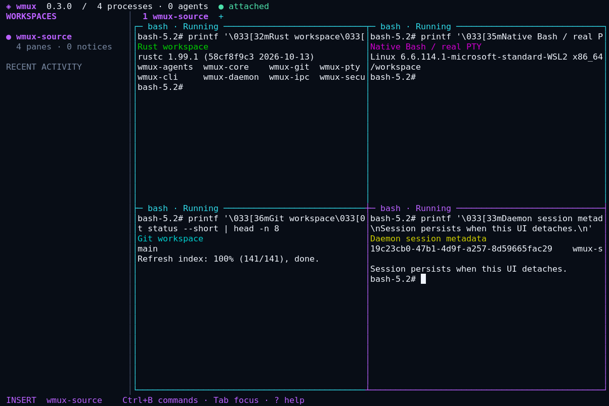

# Verification report - 2026-11-19

The tested source is [f420d14](https://github.com/peterkure3/wmux/commit/f420d14f43d9074674ffdf4a81e85d3dd7c89e7e).
It is installed as the default Windows WMUX 0.3.0. This is a usable migration
milestone, **not a production-complete release**; [remaining gates](limitations.md)
are explicit. No public release/tag was published.

## Final platform results

All jobs passed in [Rust native verification](https://github.com/peterkure3/wmux/actions/runs/44262215446)
and [Go verification](https://github.com/peterkure3/wmux/actions/runs/44262215558).

| Platform | Rust tests | Clippy / release build / installer |
| --- | ---: | --- |
| Windows x86_64 | 25 passed | Passed, including real ConPTY and host-job closure |
| Linux x86_64 | 24 passed | Passed, Bash/Unix PTY; also tested locally in Debian |
| Linux ARM64 | 24 passed | Passed natively on the GitHub ARM64 runner |

Go 1.27.4 passed Windows tests, Linux race tests, vet, dependency verification
and vulnerability scanning in CI. The final local Windows suite also passed
with packages serialized, followed by vet and govulncheck. The scanner reported
zero reachable vulnerabilities; it also reported vulnerabilities in imported
packages/modules that the application does not appear to call. This is not a
claim that every dependency is vulnerability-free.

Reproduction commands:

```sh
cargo fmt --all -- --check
cargo clippy --workspace --all-targets --locked -- -D warnings
cargo test --workspace --locked
cargo build --workspace --release --bins --examples --locked
go mod verify
go vet ./...
go test -count=1 ./...
# Linux/cgo:
go test -race -count=1 ./...
go run golang.org/x/vuln/cmd/govulncheck@v1.6.0 ./...
```

## Implemented and exercised

Eleven Rust crates separate model/config/layout, terminal emulation, PTYs,
per-user IPC/security, SQLite, agent adapters, Git, daemon, TUI and CLI.
Real terminal cells feed Ratatui; no simulated agent output is used.

Nested splits, contiguous shared borders, full-height sidebar, workspace tabs,
focus, resize, swap, rename, zoom, close, collapsible lower panels and inspector
are connected to real daemon-owned processes. Copy mode searches retained
physical history rows in both directions; repository-confined file previews
are capped at 64 KiB. Git inspection includes working/staged changes and
untracked file names; dirty worktrees are never force-deleted.

Control connections acquire exclusive write ownership for modified workspaces
and release it on disconnect. Observers remain available. Tests cover real
shell I/O, resize, detach/reconnect, high output, process failure, daemon crash,
task persistence, protocol rejection, duplicate locks, missing agents, approval
decisions/expiry, Unicode, alternate screens and terminal device replies.
SQLite tests simulate read-only and database-full transaction failures.
UI geometry tests include 80x24, 120x40, 200x60 and small-terminal fallback.

Claude/Codex command-hook contracts are opt-in and tested through real WMUX CLI
and daemon processes: explicit approval/rejection is returned as provider JSON;
missing panes deny permission. Live paid-provider/version validation remains
open. Stop means an agent turn ended, not task/process completion. Gemini/Aider
launch normally but their permission transports are not bridged.

## Actual application captures

The following are captures of xterm running the real application at 120x40,
with four live Bash PTYs and zero agents. Keyboard focus, panel expansion and
detach were exercised; a post-detach snapshot confirmed four live processes.




The installed Windows build was separately verified with four real PowerShell
PTYs, cold startup notice, warm daemon reuse, survival after CLI exit and a
command whose computed output reached the rendered screen cells. The isolated
test daemon was stopped afterward. Its text capture is a headless rendering of
real cells, not a claim of an interactive Windows screenshot.

## Installed startup policy

Plain wmux now runs Rust 0.3.0. The preserved Go pair is in legacy/ and reports
compat-f420d14; old Go commands/sessions remain accessible through wmux legacy.
Both existing executables and configuration were preserved/backed up; existing
sessions were not stopped and no live process state was migrated.

The AC-dependent wmux-wmuxd logon task was removed. Cold startup prints its
notice in the invoking terminal, and background launch does not create a command
window. Native Windows testing confirms survival when a terminal host closes a
kill-on-close job that permits breakaway. Restrictive host policy is respected
and reported rather than bypassed. No reboot test was performed.

## Measurements

Updated raw results are the continuation-* JSON files in [measurements](measurements/).
These are short development-PC samples, not performance acceptance guarantees.

| Measurement | Windows / PowerShell | Linux / Bash |
| --- | ---: | ---: |
| Native PTY echo median | 15.58 ms | 3.10 ms |
| Shell input to parsed cells median | 76.43 ms | 6.59 ms |
| Shell input maximum, ten samples | 158.42 ms | 7.46 ms |
| IPC ping mean | 0.70 ms | 0.92 ms |
| Attach snapshot mean | 2.39 ms | 1.87 ms |
| Resize acknowledgement mean | 0.56 ms | 0.62 ms |
| Headless Ratatui render mean | 1.41 ms | 0.83 ms |
| Parser throughput | 30.09 MiB/s | 22.56 MiB/s |

Idle daemon CPU measured 0% in both short samples. Windows RSS was 10,747,904
bytes; Linux RSS was 6,742,016 bytes. Under output load, one-core CPU percentages
were 44.87% and 30.76%; workloads differ (20,000 longer Windows lines versus
200,000 shorter Linux lines), so these are not throughput comparisons.
Child/agent memory and physical keyboard/display latency are excluded.

## Artifacts, fixes and limits

Checksummed Windows, Linux x86_64 and Linux ARM64 archives were produced by CI,
downloaded under build/github-artifacts/f420d14 and independently hash-verified.
Local build/rust-artifacts also contains Windows/Linux x86_64 packages. Native
local installers are included. [Installation](installation.md) documents commands.

CI exposed and resolved: an interactive PowerShell exit-test startup race;
Go's GO-2026-6859 toolchain vulnerability (upgrade to 1.27.4, minimum 1.26.11);
and PowerShell splitting an unquoted coverage filename. Local load-related
temporary-directory/PTY timing failures were recorded before the serialized
Go suite passed. Earlier screenshot locale/focus orchestration failures were
corrected and actual xterm images recaptured.

Fallow only analyzes one JavaScript integration file here. Its absent entry
point, unused-file and complexity findings are not Rust/Go architectural proof;
no source was deleted based on them. Source inspection and native tests supplied
the relevant verification.

Broader terminal/SSH/live-provider testing, arbitrary selection, richer terminal
protocols, fully nonblocking Unix readers, IPC deltas, soak profiling, signed
distribution and the other documented release gates remain incomplete.

## 0.3.1 Unix I/O follow-up

Unix PTY transport now uses nonblocking, close-on-exec descriptors registered with Tokio readiness. The real Linux PTY regression exercises sixteen panes on one Tokio thread, 64 KiB binary echo, full output/input queues, timer responsiveness and descriptor/task cleanup after cancellation. Windows ConPTY I/O is unchanged. The new test brings the Linux total to 25, matching Windows. Final native CI links and installed version are recorded after verification.

The first broad local builds exhausted the project disk. Only generated debug caches were removed after path/reparse-point checks; release binaries, source, session files and other projects were preserved. Subsequent Linux builds use a native Docker cache and disposable verification profiles omit debug symbols/incremental data. Docker was started on demand after its engine stopped; no startup settings were changed.
