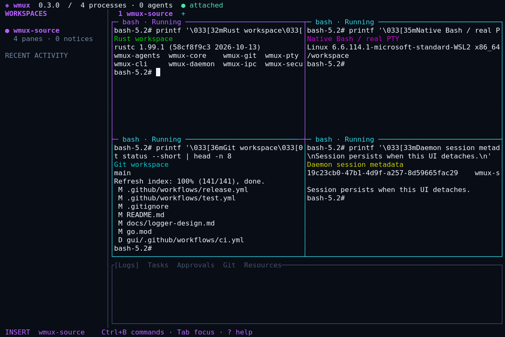

# Verification — 2026-11-17

This is a tested Rust implementation milestone. It is **not a production release**;
[remaining requirements](limitations.md) are still explicit release gates.

## Implemented and exercised

Eleven Rust crates separate model/config/layout, terminal emulation, PTYs,
security, local IPC, SQLite, agents, Git, daemon, TUI and CLI. Real ConPTY and Unix
PTY processes feed vt100/vte screen cells into Ratatui. Workspaces support nested
splits, grid/rows/columns/main-stack presets, focus, resize, swap, rename, zoom and
close. UI detach leaves processes running. Metadata/tasks/notifications/custom
approvals persist; restart never resurrects stale PIDs.

The actual xterm images below show four Bash processes, **zero agents**, and
ordinary executed shell commands. They contain no simulated agent output.
Shared borders touch, intersections join, and the sidebar reaches the status bar.
The second image follows real keyboard pane focus and lower-panel commands.

Capture: scripts/capture-linux.sh in a Debian Linux container, Xvfb and UTF-8
xterm at 120x40. A parsed post-detach snapshot verified four Running Bash panes
with live PIDs. The original capture attempt exposed a missing UTF-8 locale and
headless keyboard focus; those environment issues were corrected and the images
were recaptured and inspected. An earlier orchestration run was interrupted by
editing its capture script while it was waiting; the independent corrected
capture completed successfully. No failed image is presented as verification.

## Platforms and commands

| Check | Windows x86_64 | Linux x86_64 |
| --- | --- | --- |
| Rust unit/integration suite (24 tests) | Passed, real PowerShell/ConPTY | Passed, real Bash/Unix PTY |
| Clippy, all targets, warnings denied | Passed | Passed |
| Release executables | Built with Rust 1.99.0 MSVC | Built with Rust 1.99.1 in Debian container |
| PTY doctor (spawn/output/resize/termination) | Passed | Passed in corrected capture |
| Real full-screen UI capture | Not captured | xterm screenshots above |
| ARM64 execution / remote SSH host matrix | Not tested | Not tested |

Commands: cargo fmt --all -- --check; cargo clippy --workspace --all-targets
--locked -- -D warnings; cargo test --workspace --locked; cargo build --workspace
--release --bins --examples --locked. Linux executed ELF binaries on the Linux
kernel, not just cross-compilation.

Lifecycle coverage includes creation, shell I/O, four panes, resizing, UI
disconnect/reconnect, task persistence, missing-agent rejection, process failure,
daemon crash, unknown protocol versions, duplicate-daemon locks, explicit custom
approval decisions/expiry, and responsive independent panes during high output.
A Windows named-pipe instance gap found during reconnect testing was fixed;
a 320-request reconnect stress test now passes. Shutdown acknowledgement is
flushed before service teardown. Terminal tests cover Unicode/combining/wide
characters, alternate screens, SGR, bounded scrollback, notification callbacks
and device replies. UI tests cover 80x24, 120x40, 200x60, focus invariance and
small-terminal fallback.

The retained Go implementation passed go mod verify, go vet ./..., go build ./...
and go test -count=1 ./... on Windows with the existing Go 1.27.3 toolchain.
The Windows PTY fixture now uses a local sleep rather than ping; terminal
device replies are drained concurrently. The token provisioning test's timeout
allows slower Windows process startup while still requiring all eight helpers
to agree. Private Rust output is excluded from Go discovery with ignored
build/go.mod and target/go.mod sentinels. Go Linux race tests remain CI work.

Fallow post-change audit reported pass, but its coverage here is JavaScript only;
it supplies no Rust/Go architectural proof.

## Measurements

Raw, reproducible results are in [measurements](measurements/). These are short
release-build samples on a development PC, sometimes with other verification
workloads active. No performance acceptance threshold is claimed. Input timing
includes IPC/polling and the actual program response; it excludes keyboard
hardware, compositor and physical display latency.

| Measurement | Windows / PowerShell | Linux / Bash |
| --- | ---: | ---: |
| Single-line native PTY echo median | 15.74 ms | 3.04 ms |
| Shell-command input to parsed cells median | 357.88 ms | 8.71 ms |
| Shell-command maximum, 10 samples | 2586.32 ms | 10.39 ms |
| IPC ping mean | 3.23 ms | 1.18 ms |
| Attach initial snapshot mean | 7.26 ms | 3.65 ms |
| Resize acknowledgement mean | 1.40 ms | 1.08 ms |
| Workspace process spawn | 965.36 ms | 176.09 ms |
| Headless Ratatui render mean | 3.60 ms | 1.98 ms |
| Parser throughput | 9.09 MiB/s | 9.69 MiB/s |

The native echo fixture is an actual Rust process reading PTY input and writing
a marker. It helps distinguish transport cost from interactive-shell behavior.
The gap suggests shell/input processing and load contribute, but does not prove
their exact shares. Earlier Windows shell medians varied from 49 to 461 ms.
Windows command latency and cold startup therefore remain profiling work.

Resource samples used one real shell and no UI subscriber:

| Resource | Windows | Linux |
| --- | ---: | ---: |
| Idle daemon RSS | 10.34 MiB | 6.32 MiB |
| Output daemon RSS | 11.10 MiB | 7.42 MiB |
| Idle CPU, one-core percentage | 0.00% | 1.00% |
| Output CPU, one-core percentage | 22.29% | 33.67% |

Windows emitted 20000 longer lines; Linux emitted 200000 shorter lines. Samples
span about 2.1 seconds and are not equivalent throughput comparisons. Agent and
shell child memory is excluded. No soak-test or hard RSS guarantee is asserted.

## Artifacts and release gate

Tested native binaries are under target/release (Windows) and
build/linux-target/release (Linux). Checksummed archives are prepared under
build/rust-artifacts. scripts/package-rust.py reproduces the archives.

Rust CI was added for Windows x86_64, Linux x86_64 and Linux ARM64. The workflow
has not been executed remotely in this session; ARM64 and the broader terminal
matrix are not passing claims. No Rust release was published. Built-in provider
approval bridges, richer terminal/search/diff behavior, signing/installation and
other limitations remain in limitations.md.

## Terminal-only daemon startup

The final Windows and Linux Rust suites include a real CLI cold/warm startup test: the startup notice returns to the invoking terminal, the daemon survives CLI exit, and a second invocation reuses it. Windows native detached creation explicitly disables inherited handles; the daemon opens its own private log. The retained Go CLI also passed the complete final `go test -count=1 ./...` suite on Windows, including real binary startup integration tests. The installed launcher was separately checked against the existing installed daemon: cold startup, same-process reuse and authenticated access after CLI exit passed; Task Scheduler inventory found zero WMUX tasks after removal. No reboot was performed. See [startup policy](../startup-policy.md) for the installed launcher and logon-task change.

## Continuation: migration and reliability

The Windows suite now passes 24 tests, including persistent control ownership, bidirectional physical-history search, official Claude/Codex hook approval/rejection JSON contracts, missing-pane denial, bounded Git output, staged changes, repository-confined previews, and read-only/disk-full SQLite rollback. Full live paid-provider sessions are not claimed. Rust IPC is version 2; use matching clients and daemon.

Windows release binaries passed a local installer smoke test with the preserved Go pair: Rust --version, wmux legacy version, and legacy notify help. The approved installation changes plain wmux to Rust while old Go sessions remain behind wmux legacy. Local hooks/config are not overwritten. Native local installers and CI smoke checks were added; signed public release gates remain open.

The fresh Linux xterm capture, keyboard detach check and measured run passed after continuation changes. A final frozen-source Linux test/build/installer check and GitHub native workflow results are recorded below after completion.

The frozen-source Linux run passed all 24 tests, Clippy, release build and local installer smoke checks. Windows passed the same 24 tests and Clippy plus real compatibility installation checks. Both checksummed archives include local native installers. Updated measurement JSON files have the continuation- prefix: shell input median Windows 76.43 ms / Linux 6.59 ms, native PTY echo 15.58 ms / 3.10 ms, idle CPU 0% in both short samples. These samples do not establish performance acceptance targets.
